<table align="center" width="100%">
  <tr valign="top">
    <td align="center" width="50%">
      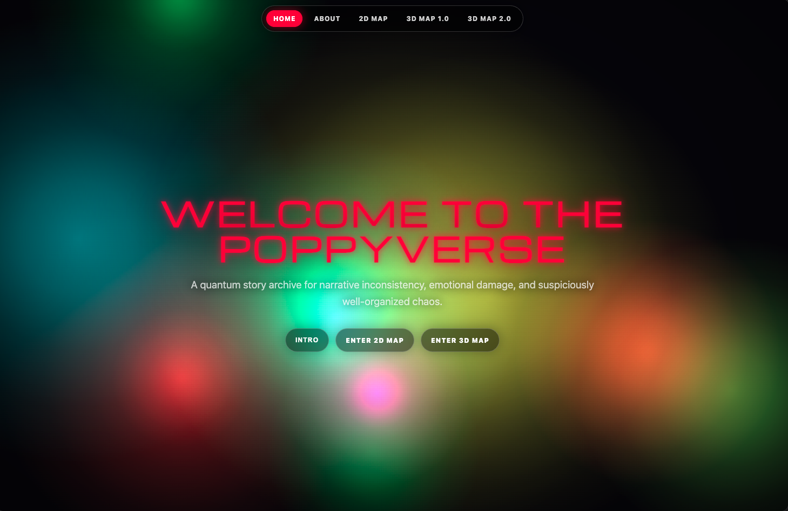
    </td>
    <td align="center" width="50%">
      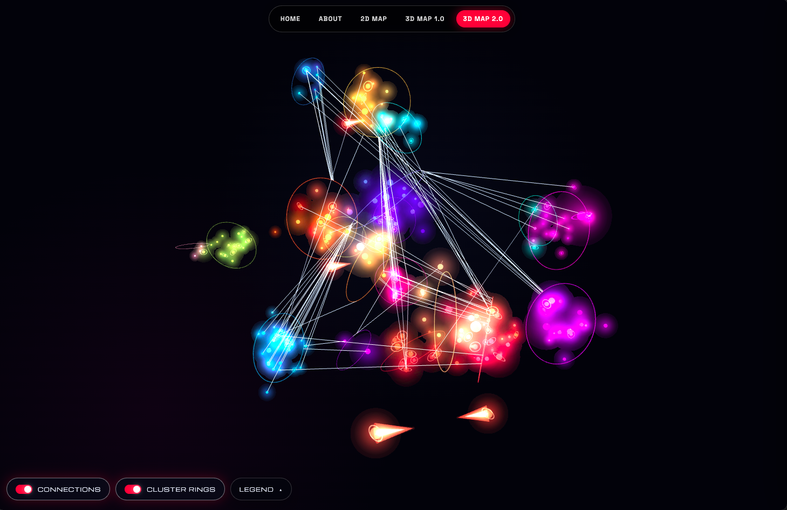
    </td>
  </tr>
</table>

<h1 align="center">The Poppyverse Interactive Map</h1>

<p align="center">
  <em>Part story map, part multiverse directory, part emotionally unstable control panel.</em>
</p>

<p align="center">
  <strong><a href="https://programminginpoppyfields.github.io/poppyverse-interactive-map/">Explore the live map</a></strong>
</p>

---

A data-driven interactive archive for navigating a large fictional multiverse through clustered dashboards, character directories, story metadata, and 2D and 3D relationship maps.

The public site exposes the maps, navigation system, character information, and story descriptions. Full story text is kept private behind password-protected access.

---

## what is this

The Poppyverse is too interconnected for a normal table of contents and too unstable for a normal map.

This project turns its stories, characters, timelines, and relationships into a browsable interface with two complementary views:

- **2D Map** — a calmer cluster-first dashboard for structured browsing
- **3D Map** — an interactive force-directed graph for seeing connections and narrative gravity

The site is generated directly from the Full Catalogue and Cluster Catalogue in Notion rather than maintained as a pile of hand-edited HTML pages. Content, metadata, relationships, and presentation logic stay separate, which makes the archive easier to expand without manually rebuilding the universe every time canon shifts.

---

## technical highlights

- Notion-backed content model shared by both map generators
- Python generators for repeatable static-site builds
- 2D cluster dashboard for structured navigation
- Interactive 3D relationship graph using Three.js and `3d-force-graph`
- Shared navigation and visual language across generated pages
- Public metadata layer with password-protected full story content
- Static GitHub Pages deployment with no application server required
- Selective build flags for regenerating only the pages that changed

---

## how it works

```text
Full Catalogue + Cluster Catalogue (Notion)
            ↓
      scripts/*.py
            ↓
generated HTML / CSS / JavaScript
            ↓
  2D dashboard + 3D graph map
            ↓
      GitHub Pages deployment
```

The Notion catalogues hold the actual archive data. Python scripts fetch and normalize the public fields in memory, then transform them into the cluster dashboard and 3D relationship graph. No intermediate CSV or raw Notion dump is written to the public repository.

The generated HTML files are outputs, not the source of truth.

---

## site structure

| Page | What it is |
|---|---|
| `index.html` | Splash page and site entrance |
| `about.html` | About H.A.H. |
| `reading_guide.html` | Reading Guide: the suggested reading logic (progressive threads, variants, wildcards) and story-music tips, formerly the home page's Intro |
| `2d_map.html` | Cluster-card dashboard with story and character metadata |
| `3d_map.html` | Cluster-ring 3D relationship graph using Three.js and `3d-force-graph` |

### Repository layout

The five pages stay at the repo root because that is where their public GitHub Pages URLs come from. Everything else lives in a folder:

| Path | What's in it |
|---|---|
| `index.html`, `about.html`, `reading_guide.html`, `2d_map.html`, `3d_map.html` | The published pages (all generated) |
| `components/` | Shared web components loaded by the pages: `poppy-nav.js`, `poppy-card.js`, `poppy-aurora.js` |
| `scripts/` | The build scripts (run `build_all.py`) |
| `screenshots/` | Images, grouped by era: `early-prototype/` (first bounding-box 3D views), `layout-experiments/` (globe, cube and divide layouts), `v1-cylinder/` (the cylinder 3D map and its detail card), `v2-rings/` (the cluster-ring map), `misc/` (home-screen shots and the original concept sketch) |
| `archive/` | Unused leftovers (the `3d-force-graph` fork source, which keeps its own upstream `LICENSE`); safe to ignore or delete |
| `.github/`, `_config.yml`, `LICENSE`, `README.md` | Repo and GitHub Pages housekeeping |

All pages share the same top navigation, a `<poppy-nav>` web component declared once in `components/poppy-nav.js`. Each page just includes the script and the tag; the component works out the current page from the URL. Edit that one file to change the menu everywhere, with no rebuild needed:

- Home
- About
- Reading Guide
- 2D Map
- 3D Map

The story/cluster detail card is a second shared component, `<poppy-card>` in `components/poppy-card.js`. The 3D map's side drawer uses the full card, and the 2D map's mobile story list uses its `variant="compact"` form. A page gives it data from JavaScript (`card.data = { title, badge, color, sections: [...] }`); the file's header comment documents the format and the `close` and `chip-select` events. Change the card's look or fields there once and both maps follow after a rebuild of the page that supplies the data. The two maps' generators still decide which fields each page passes in.

The home and About pages share a third component, `<poppy-aurora>` in `components/poppy-aurora.js`: slowly drifting, fuzzy colour blobs painted with additive blending so overlaps glow. Drop `<poppy-aurora></poppy-aurora>` in as the first thing in `<body>`; it fixes itself behind the page. Optional attributes: `count`, `speed`, `intensity`, `scale` (documented at the top of the file). It draws one still frame for visitors who prefer reduced motion. The page's `<body>` must not have its own opaque background, or it will cover the layer.


---

## source of truth

| Notion database | What it controls |
|---|---|
| **The Cluster Catalogue** | Cluster names, descriptions, colors, cover images, order, and cluster connections |
| **The Full Catalogue** | Story entries, characters, relationships, descriptions, public URLs, status, and manuscript byte counts |

---

## the current 3D model

`3d_map.html` treats clusters as large spatial rings and places their child stories throughout a three-dimensional volume around each ring. Ring size follows the combined manuscript byte count. Story volume follows manuscript size, while entries without a byte count receive a substantial default.

Story-to-story, story-to-cluster, cluster-to-story, and cluster-to-cluster relationships are rendered as straight links. Published stories receive a planetary ring; intros, e-books, and trailers use distinct shapes described in the map legend. The seeded layout is reproducible.

---

## what is a connection

The faint lines connecting nodes and cluster rings are authored through the Full Catalogue and Cluster Catalogue connection properties:

> **CONNECTION:** A connection defines a relationship between 2 stories where characters, timelines, or alternate versions of the same people from separate universes come into direct contact and begin affecting one another. Less "special crossover episode," more "the walls between realities have failed inspection."

Both concepts above show up together on a node's detail card — click any node on `3d_map.html` or `2d_map.html` to open it:

<p align="center">
  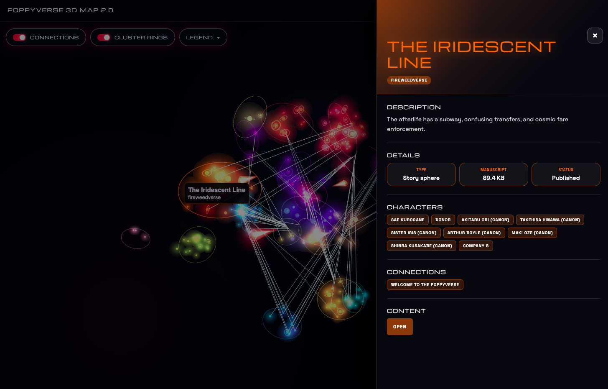
  <br />
  <sub>A story's detail card on the 3D map, populated from normalized catalogue metadata.</sub>
</p>

---

## build scripts

| File | What it does |
|---|---|
| `scripts/build_all.py` | Runs the complete active site build. It is the only script that calls Notion by default: it fetches all four catalogues once and passes normalized rows to the 2D and 3D generators in memory |
| `scripts/build_home.py` | Generates `index.html` |
| `scripts/build_about.py` | Generates `about.html` |
| `scripts/build_reading_guide.py` | Generates `reading_guide.html` |
| `scripts/build_2d_map.py` | Generates the 2D cluster catalogue from Notion |
| `scripts/build_3d_map.py` | Generates the cluster-ring 3D graph from Notion |
| `scripts/poppyverse_notion.py` | Shared read-only Notion client and normalization layer |
| `components/poppy-nav.js` | The shared top-navigation web component (links and styling), loaded by every page |
| `components/poppy-card.js` | The shared story/cluster detail card web component, loaded by the 2D and 3D 2.0 maps |
| `components/poppy-aurora.js` | The animated glowing-blobs background (`<poppy-aurora>`), loaded by the home and About pages |

You usually only need `build_all.py`.

---

## rebuilding the site

`scripts/build_all.py` reads **The Full Catalogue**, **The Cluster Catalogue**, **The Character Catalogue**, and **The Crossover Catalogue** from Notion once and hands normalized rows to `scripts/build_2d_map.py` and `scripts/build_3d_map.py` over stdin (`--snapshot -`). Character and crossover relation IDs are resolved to their catalogue titles in memory before the maps are generated. Nothing is written to disk besides the finished HTML, so no intermediate CSV or JSON export is created or committed. Either map script can still be run on its own, in which case it fetches from Notion itself.

Create a Notion connection or personal access token, grant it read access to
all four catalogue databases, then keep the token outside the repository:

```zsh
read -rs "NOTION_TOKEN?Paste Notion token: "
echo
export NOTION_TOKEN
python3 -u scripts/build_all.py
unset NOTION_TOKEN
```

The silent prompt keeps the token out of the command itself and therefore out
of ordinary shell history. The builder uses Python's installed `certifi` CA
bundle when available, reports every 100-row Notion page as it arrives, logs
retry delays, and never prints the token.

The four current data-source IDs are safe defaults in the script. They can be
overridden without editing code:

```bash
NOTION_FULL_CATALOG_DATA_SOURCE_ID="..." \
NOTION_CLUSTER_CATALOG_DATA_SOURCE_ID="..." \
NOTION_CHARACTER_CATALOG_DATA_SOURCE_ID="..." \
NOTION_CROSSOVER_CATALOG_DATA_SOURCE_ID="..." \
python3 scripts/build_3d_map.py --seed 20261108
```

The seed makes the random cluster and story placement reproducible. Change it
only when you deliberately want a new arrangement.

Text relationship fields accept catalog IDs separated by slashes, commas,
semicolons, pipes, or newlines. JSON arrays are also accepted:

- Full Catalogue `Node connections`: story-to-story links, such as
  `123 / 456 / 789`
- Full Catalogue `Cluster connections`: a multi-value relation to Cluster
  Catalogue records, producing story-to-cluster links
- Cluster Catalogue `Cluster connections`: cluster-to-cluster links
- Cluster Catalogue `Node connections`: cluster-to-story links

The last two Cluster Catalogue properties are optional; add them when those
connection types are ready to be authored. Cluster membership itself is shown
spatially and does not create a visible spoke for every child.

Published nodes receive a small planetary ring. Entries whose type is
`youtube` are free-floating sphere-headed comet nodes, and entries with `intro`
in the title use triangular pyramids. Story colors receive a small deterministic
hue shift around their Cluster Catalogue color so sibling glows can mingle
without losing their cluster identity. Cluster ring radius is derived from the sum of child
manuscript bytes, with a minimum radius large enough to hold its children.
Story-sphere volume scales with manuscript bytes; entries with no byte count
use a substantial default equivalent to 100,000 bytes. The final visual radius
is multiplied by 1.5 for readability while preserving those byte proportions.

The generated HTML contains only the normalized public display data required
by the map; the Notion token and raw database responses are never embedded.

---

From the repository root:

```bash
python3 -u scripts/build_all.py
```

This regenerates:

```text
index.html
about.html
reading_guide.html
2d_map.html
3d_map.html
```

The normal update flow is:

1. Update The Cluster Catalogue and/or The Full Catalogue in Notion.
2. Set `NOTION_TOKEN` in the current shell.
3. Run `python3 -u scripts/build_all.py`.
4. Review the generated pages locally.
5. Commit the source data, generator scripts, and generated outputs.
6. Let GitHub Pages do its thing.

---

## optional build shortcuts

With no arguments `build_all.py` rebuilds everything. Name the pages you want and it rebuilds only those (`home`, `about`, `guide`, `2d`, `3d`):

```bash
python3 -u scripts/build_all.py 2d          # just the 2D map
python3 -u scripts/build_all.py 2d 3d       # both maps
python3 -u scripts/build_all.py home about guide  # static pages only (no Notion token needed)
```

Notion is only contacted when `2d` and/or `3d` is among the pages.

Useful when the cursed glowing space cube does not need to be awakened.

---

## local preview

After rebuilding:

```bash
python3 -m http.server 8080
```

Then open:

```text
http://localhost:8080/index.html
```

---

## public and private content

The public experience is designed to make the structure of the Poppyverse visible without publishing the full text of every story.

Publicly available:

- cluster dashboards
- character directories
- story titles and descriptions
- relationship maps
- navigation and archive metadata

Password-protected:

- full story text

This boundary keeps the interactive system open for exploration while preserving the underlying writing as a private archive.

---

## deployment notes

GitHub Pages serves `index.html` as the homepage.

The primary generated pages live beside it:

```text
/index.html
/about.html
/reading_guide.html
/2d_map.html
/3d_map.html
```

Do not hand-edit the generated HTML unless you enjoy losing those changes the next time the build runs. Update Notion or the generator scripts instead.

---

## attribution

The 3D visualization builds on the open-source [`3d-force-graph`](https://github.com/vasturiano/3d-force-graph) project by [vasturiano](https://github.com/vasturiano).

The surrounding archive system, content model, Python build pipeline, 2D dashboard, navigation, styling, and Poppyverse-specific interaction design were developed for this project.

---

## graph experiments

The 3D map's layout has been rebuilt more than once. These are snapshots from different experiments along the way — not necessarily what the live map looks like right now:

<table align="center" width="100%">
  <tr valign="top">
    <td align="center" width="50%">
      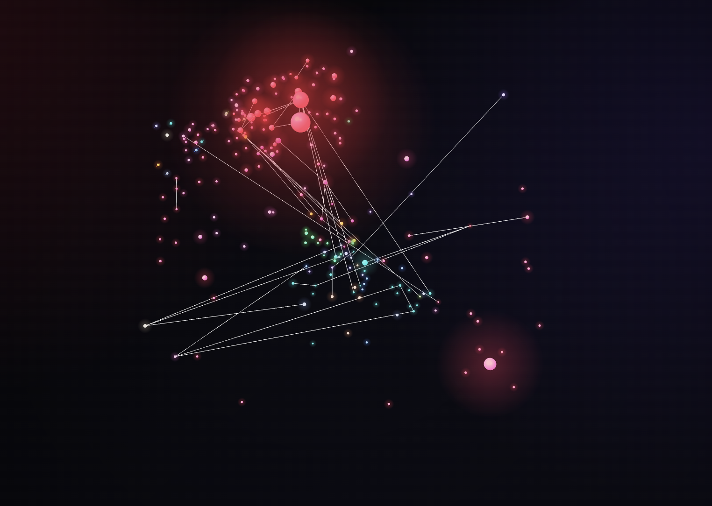
      <br />
      <sub>Layout experiment</sub>
    </td>
    <td align="center" width="50%">
      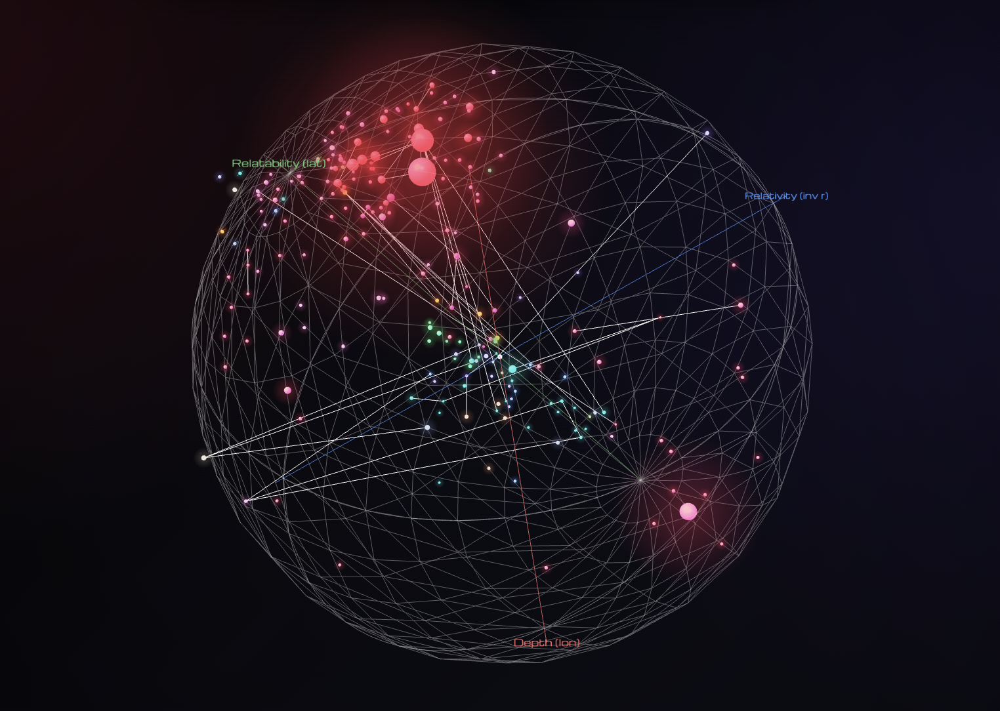
      <br />
      <sub>Spherical globe layout experiment, axes revealed</sub>
    </td>
  </tr>
  <tr valign="top">
    <td align="center" width="50%">
      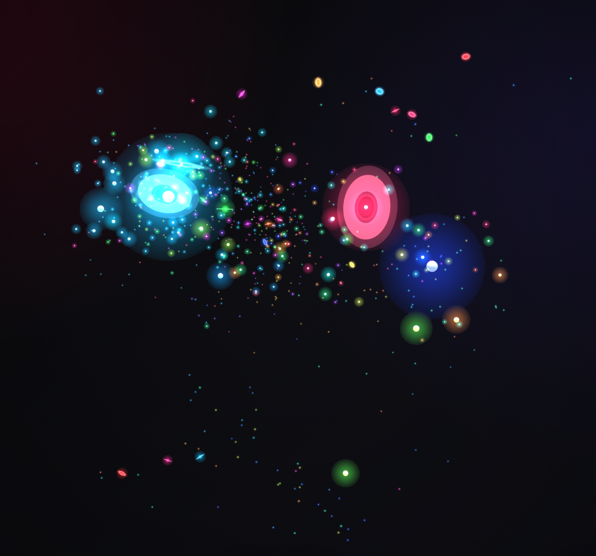
      <br />
      <sub>Scatter/divide layout experiment</sub>
    </td>
    <td align="center" width="50%">
      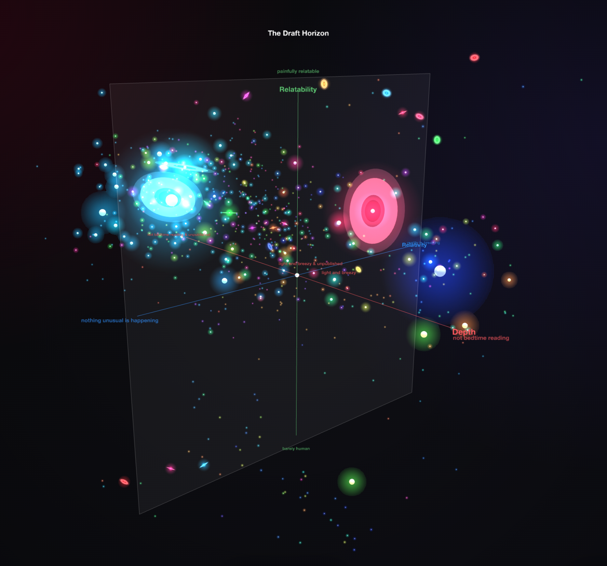
      <br />
      <sub>Scatter/divide layout experiment, axes revealed</sub>
    </td>
  </tr>
  <tr valign="top">
    <td align="center" width="50%">
      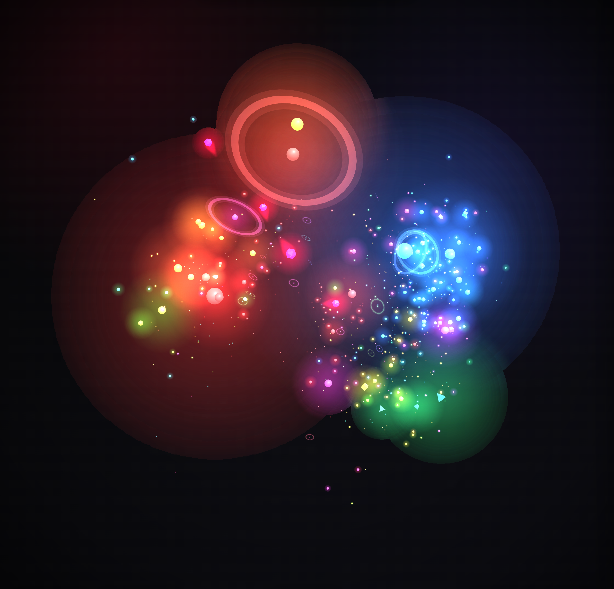
      <br />
      <sub>Cube layout experiment</sub>
    </td>
    <td align="center" width="50%">
      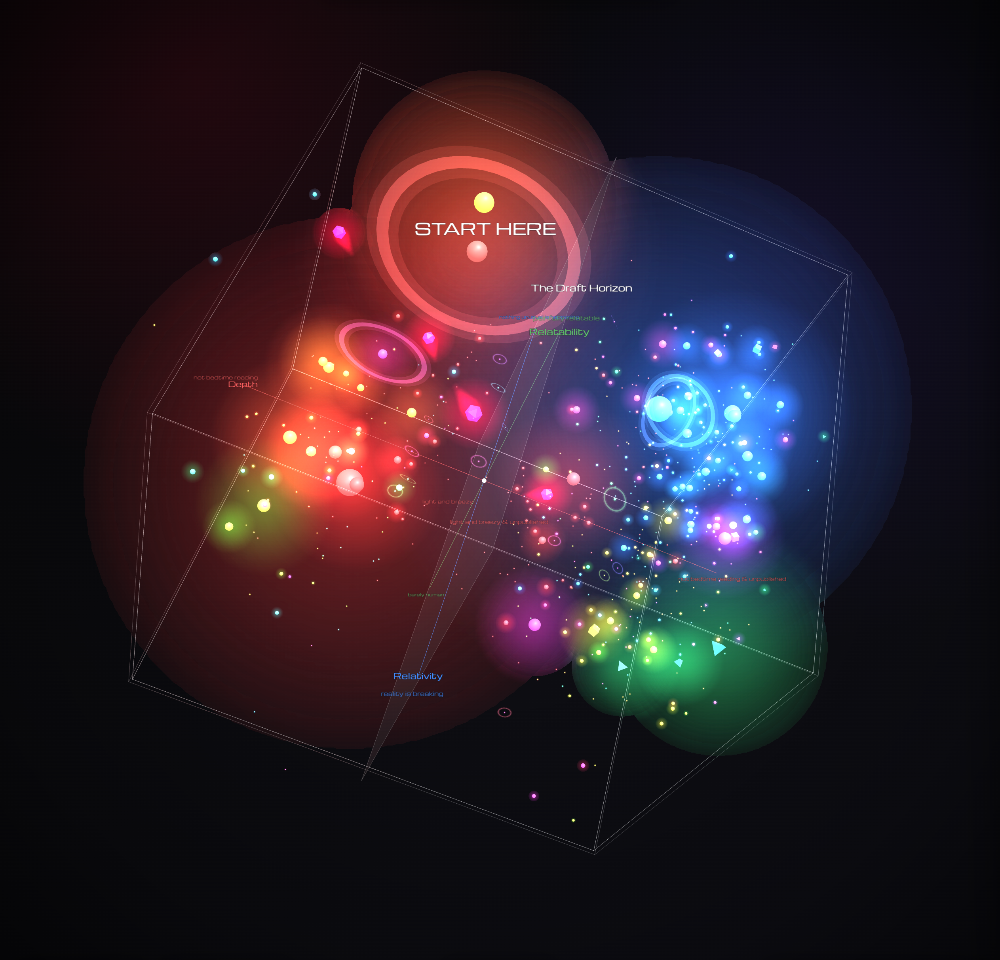
      <br />
      <sub>Cube layout experiment, axes on</sub>
    </td>
  </tr>
  <tr valign="top">
    <td align="center" width="50%">
      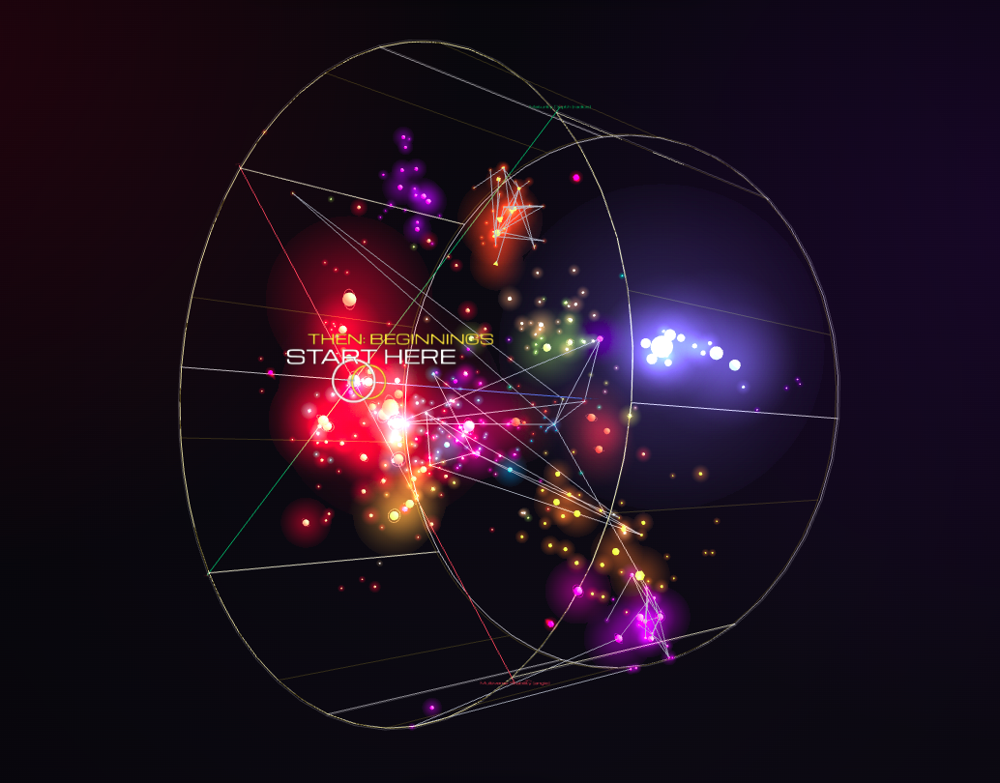
      <br />
      <sub>Cylinder layout, axes on</sub>
    </td>
    <td align="center" width="50%">
      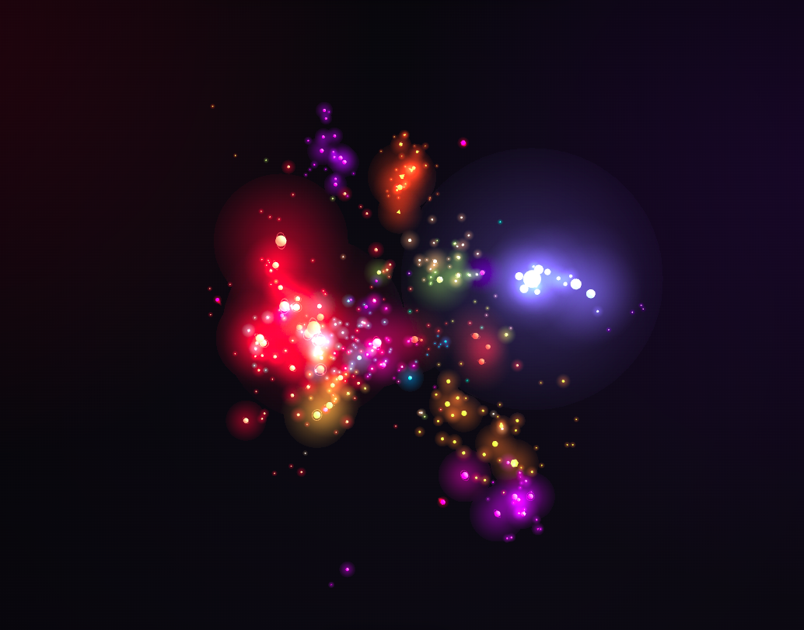
      <br />
      <sub>Cylinder layout, axes off</sub>
    </td>
  </tr>
</table>

---

## notes

3D space is a suggestion.  
Canon is unstable.  
Coherence is temporary.  
The build script is load-bearing emotional infrastructure.
